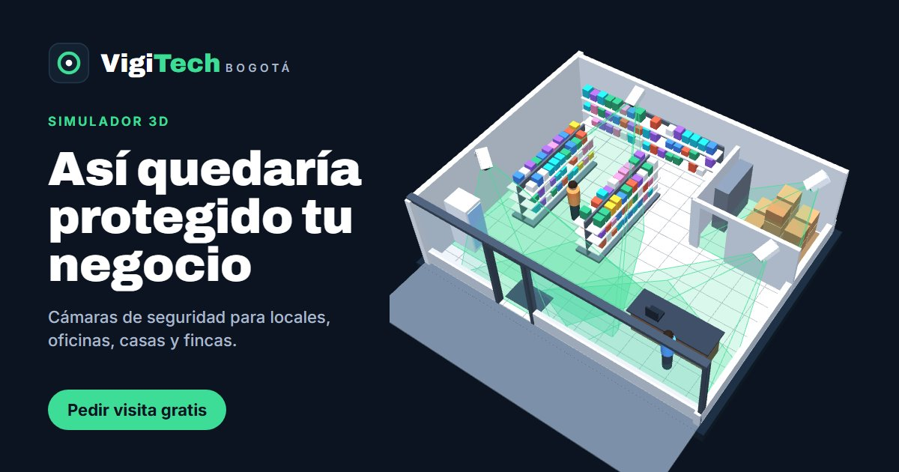

# VigiTech Bogotá

**Mira en 3D cómo quedaría protegido tu negocio antes de instalar una sola cámara.**

Página web de VigiTech Bogotá, empresa de instalación de cámaras de seguridad para locales, oficinas, casas y fincas en Bogotá. El cliente elige su tipo de lugar, gira una maqueta 3D con cuatro cámaras y su zona de cobertura, ve en un celular lo que grabaría cada una y cotiza en un minuto por WhatsApp.



## Qué tiene

- **Simulador 3D** con 4 escenas: local, oficina, casa y finca.
  - Cada escena trae 4 cámaras con su cono de cobertura proyectado sobre el piso.
  - Se gira con el mouse o el dedo, tiene zoom y gira solo cuando nadie lo toca.
  - Al elegir una cámara, se ilumina y las demás se atenúan.
- **Vista en vivo en el celular**: una cuadrícula 2×2 que muestra lo que graba cada cámara, con hora real y punto de grabación. Una persona camina por cada escena para que se vea el movimiento.
- **Cotizador**:
  - Calcula el precio según el lugar, el tipo de cámara (análoga, IP de cable o WiFi) y la cantidad, y muestra el 50 % de anticipo.
  - Envía la cotización por WhatsApp con el mensaje ya armado.
  - Con 5 cámaras o más, la cotización la hace un asesor.
- **Catálogo** de los equipos que se instalan (HiLook y Ezviz), con ventajas, desventajas y para qué lugar sirve cada uno.
- Secciones de materiales, forma de trabajo, preguntas frecuentes y contacto.

## Calidad

| Lighthouse (celular) | Puntaje |
| --- | --- |
| Rendimiento | 91–92 |
| Accesibilidad | 100 |
| Buenas prácticas | 100 |
| SEO | 100 |

- Funciona desde 375 px de ancho, sin scroll horizontal.
- Navegable con teclado: las pestañas siguen el patrón de WAI-ARIA y el foco es visible.
- Respeta la opción "reducir movimiento" del sistema.
- Al compartir el enlace en WhatsApp o redes aparece una vista previa con imagen (Open Graph).

## Tecnología

- **React 19 + Vite**, en JavaScript y solo con hooks.
- **three.js 0.128** montado a mano dentro de un componente, sin `@react-three/fiber`.
- CSS normal: un archivo por componente y variables de color globales.
- Dependencias: solo `react`, `react-dom` y `three`.

### Detalles de implementación

- **Conos de cobertura**: las 4 esquinas del campo de visión se proyectan sobre el piso y se recortan con los muros usando el algoritmo de Sutherland–Hodgman. Los conos van en una capa aparte, así que no salen en las vistas del celular.
- **Menos llamadas de dibujo**: las piezas que no se mueven se unen en una sola malla por material. El visor pasa de ~280 a ~50 llamadas de dibujo por cuadro.
- **Carga diferida**:
  - three.js se descarga después de que la página carga.
  - Cada escena se baja solo cuando se elige.
  - Los shaders se compilan de a uno por cuadro, así que la página no se congela.
- **Ahorro de recursos**:
  - El render se pausa cuando el visor o el celular salen de la pantalla.
  - El renderer del celular se crea solo cuando el celular aparece en pantalla.
  - Al cambiar de escena se libera la memoria de la GPU.

## Correrla en tu computador

Necesitas [Node.js](https://nodejs.org) 20 o más reciente.

```bash
npm install        # solo la primera vez
npm run dev        # abre http://localhost:5173
```

```bash
npm run build      # genera la versión final en dist/
npm run preview    # muestra esa versión en http://localhost:4173
npm run lint       # revisa el código
```

## Publicarla

Está lista para **Vercel**:
1. Importa el repositorio en vercel.com. Detecta Vite solo: build `npm run build`, salida `dist`.
2. Pulsa Deploy.

Cada `git push` a `main` publica una nueva versión.

También funciona en **GitHub Pages**, porque el build usa rutas relativas. Compila con la dirección final para que la vista previa al compartir apunte bien:

```bash
SITE_URL=https://TU-USUARIO.github.io/vigitech-bogota npm run build
```

## Dónde cambiar cada cosa

| Qué | Archivo |
| --- | --- |
| **Precios** del cotizador (`base` y `porCámara`), anticipo y lo que incluye cada tipo | `src/config/precios.js` |
| **Número de WhatsApp**, número visible, Instagram y mensaje de "Pedir visita" | `src/config/negocio.js` |
| Títulos por lugar ("Así quedaría protegida tu casa"…), nota bajo el simulador | `src/config/lugares.js` |
| Cámaras de cada escena: nombre, descripción, "por qué", posición, ángulo | `src/scenes/local.js`, `oficina.js`, `casa.js`, `finca.js` |
| Catálogo (modelos, ventajas, desventajas, "Ideal para") | `src/components/Catalog.jsx` |
| "Lo que instalamos en tu lugar" | `src/components/Installation.jsx` |
| "Cómo trabajamos" (4 pasos) | `src/components/HowWeWork.jsx` |
| Preguntas frecuentes | `src/components/FAQ.jsx` |
| Textos del inicio, cotizador y contacto | `src/components/Hero.jsx`, `QuoteForm.jsx`, `Contact.jsx` |
| Título y descripción para Google y al compartir | `index.html` |
| Imagen al compartir (1200×630) | `public/og-image.jpg` |
| Colores y tipografías | `src/index.css` (variables al inicio) |

Fórmula del cotizador: **total = base + porCámara × cantidad**.

## Cómo está organizado

```
src/
  App.jsx            Estado compartido: lugar elegido y cámara seleccionada
  components/        Una sección por archivo (.jsx + .css)
  config/            Precios, datos del negocio y textos por lugar
  scenes/            Las 4 escenas 3D (datos + geometría), cargadas bajo demanda
  three/             Lógica 3D: armar escenas, conos, vistas del celular, optimizaciones
```

## Contacto

**VigiTech Bogotá**
- WhatsApp: [320 985 4151](https://wa.me/573209854151)
- Instagram: [@vigitechbogota](https://www.instagram.com/vigitechbogota/)
